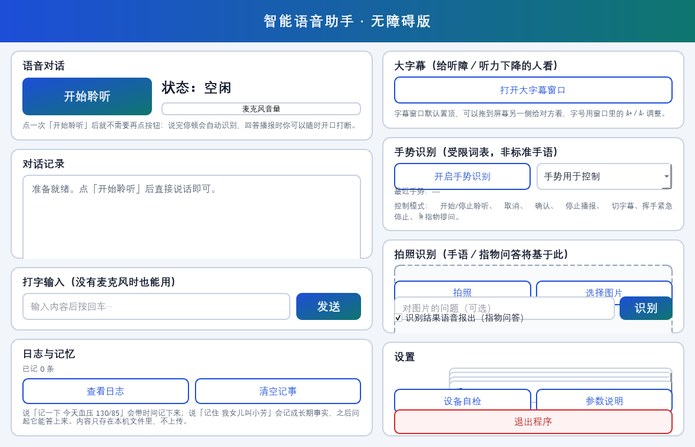

# multimodal_assistant · 不用按键的桌面助手

面向**不便操作键盘与屏幕**的场景，做一个不用按键、能听、能看、能说的交互入口。

老年人、行动不便者、听障与言语障碍人群用电脑，卡的往往是同一件事：**够不着键鼠、
看不清小字、听不清声音、说不出话**。现有语音助手多是"按一下说一句"的命令式交互，
既应付不了说话慢、爱重复、中途改口，也没法在播报中途被打断；聋哑用户更缺一条
"把自己的意思表达出去"的通道。

这个项目把语音做成**连续、可打断、可确认**的一条流，再补一条**视觉通道**
（手势转语音、语音转大字幕），全程按适老化做界面。

```
麦克风 ─┐
        ├─→ VAD 自动断句 ─→ 识别 ─→ 大模型流式 ─→ 分句流式播报 ─→ 扬声器
回环   ─┘      ↑                                        ↑
（WASAPI）  回声消除（NLMS）                        播报中打断检测
摄像头 ─→ 手部 21 关键点 ─→ 手势分类 ─→ 控制动作 / 手势说话 / 指物问答
```



---

## 一、它解决什么

| 用户 | 卡在哪 | 这里给的通道 |
|---|---|---|
| 老年人 / 行动不便 | 不会用键鼠、看不清小字 | 语音免手操作 + 慢速播报 + 大字幕 + 指物问答 |
| 听障 / 听力下降 | 听不见对方说话 | **语音 → 大字幕**（置顶大字号，可把屏幕转给对方看） |
| 聋哑 / 言语障碍 | 说不出话 | **手势 → 语音**（识别成短语读出来）+ 数字手势 |

## 二、能力清单

**能听**：点一次「开始聆听」之后不用再点任何按钮。说完停顿约 0.8 秒自动断句，
识别前先播一句极短的即时应答音（"嗯，我看看。"），让人知道"它听见了"。

**能说**：回复**逐句流式播报**——模型产出一句就合成一句、立刻出声，不等全文。
播报中随时可以开口打断，程序停下播报并转回聆听。

**能看**：OpenCV 取帧后 Base64 交给视觉模型，完成识物与读屏；MediaPipe 取手部
21 个关键点，几何规则分类成手势，既能操作程序，也能当"说话"用。

**能操作**：音量、开程序、开常用网站、读剪贴板、读屏幕上的字、报时间，走**本地规则**
直接执行，不经大模型（界面响应约 20 毫秒）。

**能记**：说的内容存成本地日志与长期事实，之后问起能检索出来。

## 三、几个关键决定

**1. 为什么非要分句流式**
首响延迟 = 识别 + 等模型出全文 + 等合成全文。旧写法在真机上很容易 8~15 秒。
改成"每产出一句就合成一句并立刻播"之后，首句出声的等待被压到"第一句生成完"，
长回复也不用干等十几秒。

**2. 为什么回声消除是前提，不是加分项**
"一直听"会遇到一个死结：播报时麦克风会听见自己的声音。不处理，程序会把自己的播报
当成用户插话，逻辑立刻错乱。所以用 WASAPI 回环拿"系统正在播放什么"作参考信号，
块 NLMS 自适应滤波抵消回声，VAD 接在**残差**上而不是原始麦克风上。

**3. 为什么本地指令不经过大模型**
这类操作必须立刻执行（"声音大一点"多等一秒都别扭），而且要可预测。打开程序走
**白名单**，不在表里的一律拒绝并说明——绝不把模型输出直接当命令执行
（自检里验证过：连 `打开 C:\Windows\System32\cmd.exe` 也会被拒绝）。

**4. 为什么手势用几何规则而不是训练分类模型**
静态手势的判据本来就是几何量（哪几根手指伸直、拇指朝哪边）。规则不需要数据集、
改词表不用重训、出错能查，而且**可以离线自检**——用合成关键点就能验证分类器。

**5. 为什么记忆用字符二元组而不是向量库**
纯本地 JSON，数据不出机器；中文短句用 2-gram 重合度就够，打分可解释、可调试。
上万条再换 embedding 才有意义，现在换是过度设计。事实（如"我女儿叫小芳"）每轮注入，
日志只在**相关时**检索——两类是分开存的。

## 四、四段并行与线程模型

对话引擎里采集、识别、生成、播报不是串行的：

```
采集线程（ContinuousListener）  回调把"一句话"放进任务队列
工作线程（DialogueEngine）      ASR → LLM 流式 → 把句子推给播报器
播报线程（SpeechPlayer）        逐句合成 + 播放，可被 interrupt 打断
界面线程（PyQt5）               只处理 Qt 信号，不碰引擎内部状态
```

三类线程之间只用**队列与 Event** 通信，不共享可变状态。网络 IO（edge-tts、
云端合成、视觉模型）走 asyncio 事件循环；引擎回调发生在工作线程里，
经 Qt 信号**排队**回界面线程，所以界面不会卡死，也绝不会从工作线程直接碰控件。

## 五、技术栈

| 层 | 选型 |
|---|---|
| 语言 / 界面 | Python 3.9、PyQt5 5.15（信号槽 + QThread） |
| 采集 | PyAudio、pyaudiowpatch（WASAPI 回环）、webrtcvad-wheels |
| 语音识别 | SenseVoiceSmall（硅基流动，OpenAI 兼容接口） |
| 对话 | Qwen2.5-7B-Instruct 流式（关闭思考模式） |
| 语音合成 | edge-tts（默认，本地免费）/ CosyVoice2（云端，可选音色） |
| 视觉 | OpenCV 取帧 + Qwen3-VL（Base64 图像）、MediaPipe HandLandmarker |
| 并发 | asyncio（网络 IO）+ 线程与队列（管道并行） |
| 播放 | pygame |

依赖约束写在 `requirements.txt` 顶部：**numpy 必须 < 2**（mediapipe 要求），
实测可行组合是 numpy 1.24.4 + opencv-contrib-python 4.11。

## 六、实测数据

| 环节 | 实现 | 实测 |
|---|---|---|
| 断句 | webrtcvad 帧级检测 + 首尾 padding + 尾静音裁剪 | 自检切句 1620ms（期望 1600ms） |
| 回声消除 | 块 NLMS，WASAPI 回环作参考 | 收敛后 **ERLE 10.0 dB**；回声残差 0.00018 vs 插话 0.0234（130 倍） |
| 打断检测 | 能量比 + 本底自适应 + 带泄漏累加器 | 回声段比值 0.82 / 插话段 170.67，触发延迟约 260ms，误触发 0 |
| 识别 | SenseVoiceSmall | 稳态 0.2~0.4 秒；实测抖动到过 **14 秒、18.6 秒**（故设 20 秒超时 + 重试） |
| 对话 | Qwen2.5-7B-Instruct | 首 token **294 ms**；开启思考模式时首字 37s → 关闭后 0.79s |
| 手势 | MediaPipe + 几何规则 | 模型加载 0.25s、**单帧 12ms**（实时要求 <100ms） |
| 本地指令 | 正则路由 + 程序白名单 | 界面响应约 **20ms**（走云端一轮是数秒） |

## 七、快速开始

Windows + Python 3.9：

```powershell
pip install -r requirements.txt
python main.py            # 或双击 run.bat
```

首次使用填 API Key（[硅基流动](https://siliconflow.cn)）：

```json
// config.local.json —— 已在 .gitignore 里，也可用环境变量 SILICONFLOW_API_KEY
{ "API_KEY": "sk-你的密钥" }
```

手部模型需放在 `models/hand_landmarker.task`（约 7.5MB，不进仓库，程序会提示下载地址）。

## 八、目录结构

```
multimodal_assistant/
├── main.py                     程序入口
├── config.py                   全部配置（模型、阈值、词表、白名单）
├── core/
│   ├── audio_input.py          VAD 断句 / NLMS 回声消除 / 打断检测（算法层，可离线自检）
│   ├── continuous_listener.py  麦克风 + WASAPI 回环 双流采集（设备层）
│   ├── dialogue.py             连续对话引擎（状态机 + 分句流式播报 + 确认式交互）
│   ├── stt.py / llm.py / tts.py / player.py   识别 / 对话 / 合成 / 播放
│   ├── vision.py               取帧 + Base64 + 视觉模型
│   ├── gesture.py              手部关键点 → 手势分类 / 防抖 / 挥手 / 词表
│   ├── commands.py             本地指令（启动程序白名单、音量、剪贴板、读屏）
│   ├── memory.py               日志与长期事实（本地 JSON + 二元组检索）
│   └── text_utils.py           播报前清理 markdown 与表情
├── ui/
│   ├── main_window.py          主窗口（适老化 + 连续对话 + 手势 + 指物问答）
│   └── subtitle_window.py      大字幕面板（置顶、可调字号、三种来源配色）
├── libs/typing_extensions.py   内置补丁：避开 base 环境 typing_extensions 过旧导致 openai 导入失败
└── docs/                       截图与截图脚本
```

## 九、自检（不用启动界面）

每个核心模块都能单独跑，算法层的自检用合成信号，确定性可复现：

```powershell
python -m core.audio_input            # 断句 / 回声消除 / 打断三项算法自检
python -m core.continuous_listener --probe   # 设备探针（只读电平，不出声不落盘）
python -m core.gesture                # 手势分类 / 防抖 / 挥手
python -m core.dialogue               # 分句器（离线）
```

## 十、已验证 / 待验证

**已验证（有真实运行数据）**

- 断句、回声消除、打断三项算法自检（合成信号）
- 设备探针：麦克风 33.6 块/秒（期望 33.3），回环设备配对正确，主循环不被回环阻塞
- 真机链路：4.4 秒真实录音 → 识别准确 → 首 token 294ms → 正常播报
- 整体联调 9/9 通过：跨线程信号到达界面、大字幕实时、本地指令不经大模型、记忆写入与检索、
  且未污染用户的真实记忆文件（测试用临时库）
- 确认式交互 15 个用例（含"没错"这类否定陷阱）
- 手势分类 10/10、防抖只触发一次、挥手可检出且手掌静止不误检
- 记忆端到端 3/3：「我女儿叫什么」→「你女儿叫小芳。」

**待验证（需要安静环境或人手在镜头前）**

- 真机打断延迟、扬声器外放时的真实 ERLE（本机默认输出是耳机，没有回声路径）
- 摄像头实时手势、指物问答端到端

## 十一、边界

1. **不是完整手语识别**。本项目做的是受限词表的静态手势（外加"挥手"一种运动手势），
   词表自定义。完整手语是"手形 + 位置 + 运动 + 面部表情"的语法系统，需要带时序标注的
   数据集与训练模型，属研究级课题。
2. **数字手势**只支持 一/二/三/四/五/六/八；七、九、十依赖更细的指节弯曲与三维姿态，
   当前不支持——宁可说"不支持"，也不装作能识别。
3. **ASR 有抖动**：稳态 0.2~0.4 秒，但实测出现过 14 秒、18.6 秒。系统按
   "预热 → 超时重试 → 降级提示重说"三层兜底，即时应答音放在识别**之前**播
   （早期放在识别之后，用户要对着空气干等十几秒，安抚作用完全失效）。
4. **回声消除的前提**是能拿到"系统正在播放什么"。戴耳机时不存在回声路径，
   程序自动判定为"无回声"，改用语音门控的打断检测。
5. **分句播报目前顺序合成**：下一句要等当前句播完才开始合成，多句回复每句多花 2~3 秒。
   下一步是预合成下一句与当前句播放重叠，不影响正确性。
6. **唤醒词未实现**：`config.WAKE_WORD_ENABLED` 与依赖已就位，但当前靠按钮开启，
   麦克风在点击之前不会打开。这是隐私上的取舍，不是遗漏。